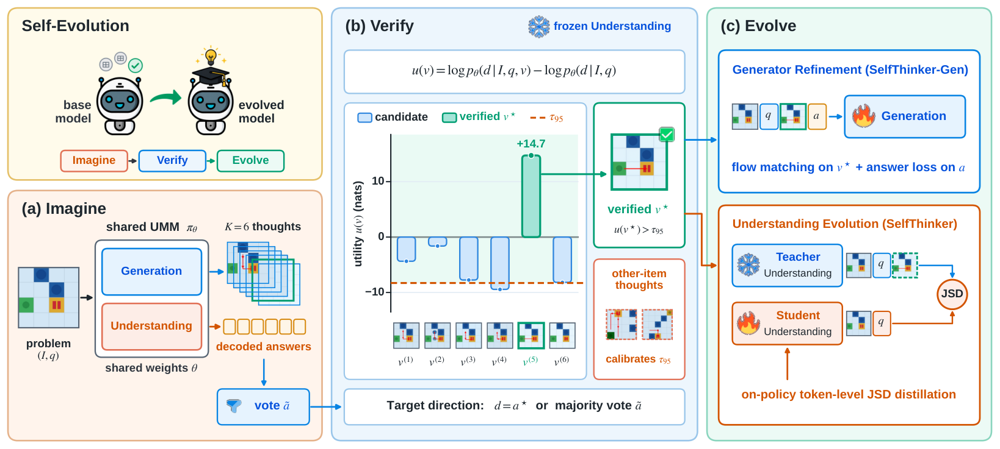
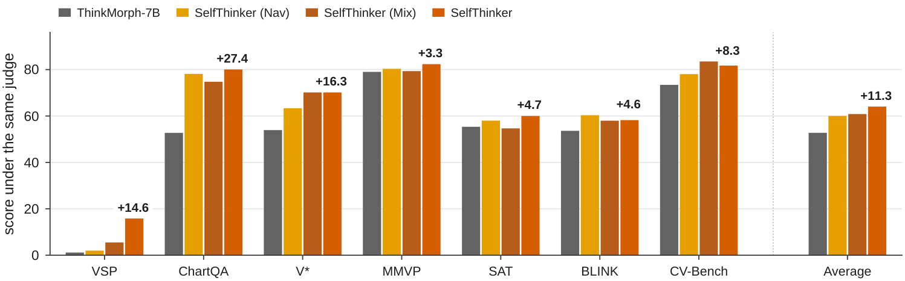
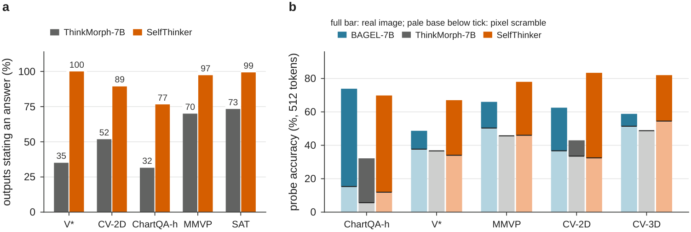
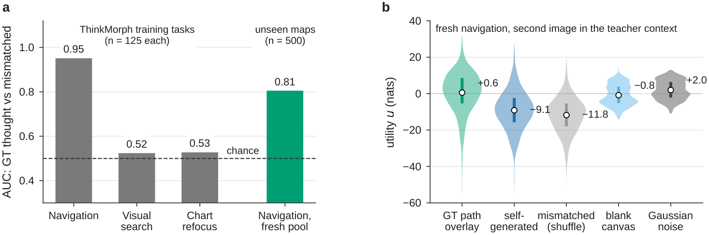
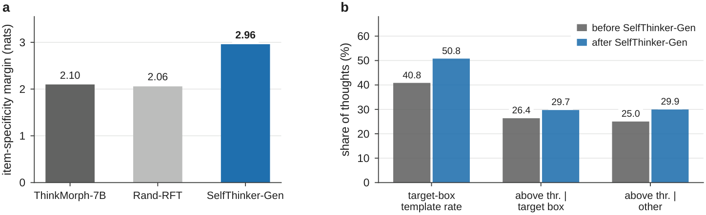
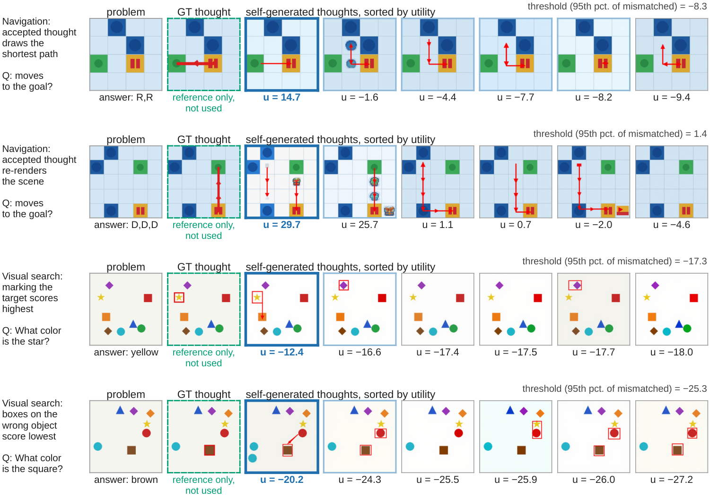
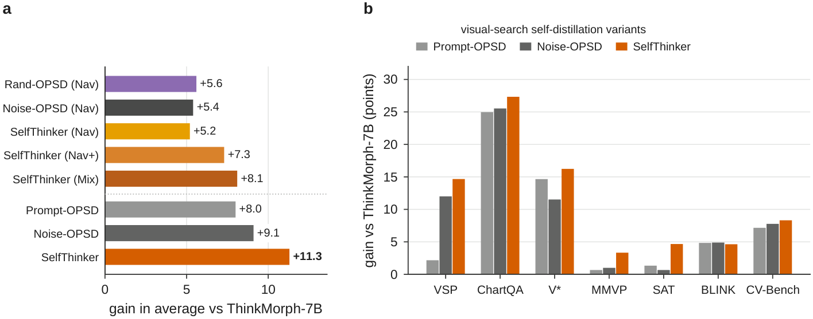
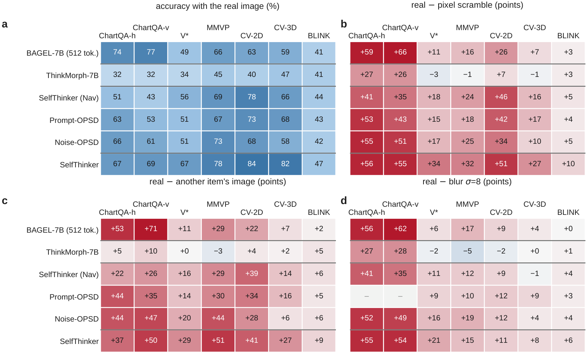
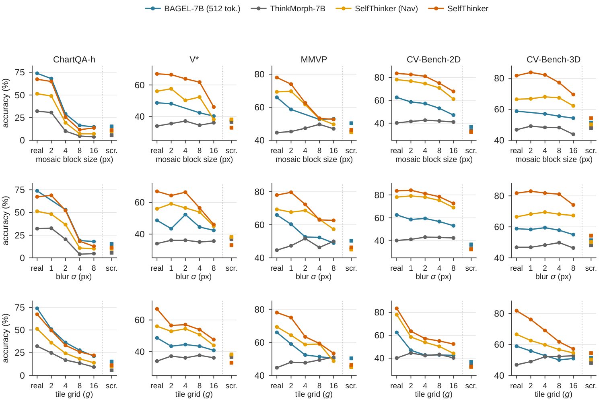

<div align="center">

# SelfThinker: Self-Evolving Reasoning via Reliability-Verified Intrinsic Visual Thoughts

[](https://huggingface.co/jankin123/SelfThinker-7B)
[](https://huggingface.co/jankin123/SelfThinker)
[](https://github.com/zhangquanchen/SelfThinker)
[](third_party/visual_opsd/LICENSE)

</div>

Unified multimodal models can synthesize intermediate visual thoughts and reason over them within a single set of weights, whereas existing pipelines depend on human-designed helper-image templates and external rendering tools. **SelfThinker** is an image-annotation-free self-evolving framework that converts a unified model's intrinsic visual thoughts into stronger single-image understanding—without human image annotations or test-time drawing latency.

- **Models:** [https://huggingface.co/jankin123/SelfThinker-7B](https://huggingface.co/jankin123/SelfThinker-7B)
- **Data:** [https://huggingface.co/jankin123/SelfThinker](https://huggingface.co/jankin123/SelfThinker)
- **Code:** [https://github.com/zhangquanchen/SelfThinker](https://github.com/zhangquanchen/SelfThinker)

<p align="center">
  
</p>

---

## Highlights

- **Intrinsic Visual Verification (`Imagine` $\rightarrow$ `Verify`):** Given a visual problem $x=(I, q)$, the model samples $K=6$ candidate visual thoughts $\{v^{(k)}\}_{k=1}^{K}$ and evaluates each candidate with its frozen understanding pathway via conditional pointwise mutual information (PMI):

$$u(v) = \log p_\theta\big(d \mid C(I, q, v)\big) - \log p_\theta\big(d \mid C(I, q)\big)$$

  calibrated within each item against the order-statistic filter $Q_i$ of utilities scored on mismatched thoughts ($v_{\mathrm{mis}}$) drawn for other problems. The target direction $d$ supports both ground-truth answers $a^\star$ (**SelfThinker**) and label-free rollout majority voting $\tilde{a}$ (**SelfThinker (Vote)**).
- **Internalizing Visual Supervision into Understanding (`Evolve`):** Verified visual thoughts serve as privileged teacher context $c_T = [I, q, \rho, v^\star, \tau]$ for on-policy token-level Jensen–Shannon divergence (JSD) self-distillation from a stop-gradient EMA teacher into a single-image student $c_S = [I, q]$, raising the seven-benchmark average over ThinkMorph-7B from **52.7 to 64.0** (**$+11.3$ points**, and to **63.4** or **$+10.7$ points** under label-free vote supervision) with zero test-time image-generation latency.
- **Statistically Significant Gains over Teacher Controls:** 10,000-resample paired item-level bootstrap tests confirm that conditioning the teacher on reliability-verified visual thoughts significantly outperforms both `Prompt-OPSD` ($+3.3$ points, 95% CI $[+1.7, +5.0]$, $p < 10^{-4}$) and `Noise-OPSD` ($+2.2$ points, 95% CI $[+0.8, +3.8]$, $p = 0.0015$), with multi-seed stability across 13 answer-directed seeds ($62.4 \pm 1.0$) and 11 label-free vote seeds ($61.9 \pm 0.8$).
- **Supporting Generative Refinement (`SelfThinker-Gen`):** Refining the generation pathway on verified thoughts via rectified flow matching raises the unseen navigation specificity margin from **2.10 to 2.96 nats** ($+0.90$ nats over random-thought fine-tuning `Rand-RFT`), lifts Top-1 AUC from **0.821 to 0.847**, increases red-box template generation on visual search from **40.8% to 50.8%**, and lifts true ground-truth target-object box localization from **12.8% to 17.7%** ($+38\%$ relative).
- **Broad Cross-Task Perception Transfer:** Training on a compact pool of synthetic visual-search and navigation items transfers broadly to natural-image perception and 2D/3D spatial reasoning, surpassing ThinkMorph-7B by up to **40.4 points** and the pretrained BAGEL-7B-MoT backbone by **12.0 to 23.2 points** across V\*, MMVP, CV-Bench-2D, and CV-Bench-3D.

---

## Main Results

### Seven-Benchmark Evaluation

Evaluated across seven multimodal benchmarks under a unified judge (`Qwen3-30B-A3B-Instruct-2507`) and greedy text-only decoding (`max_think_token_n=1024`). `ChartQA` is the mean of horizontal and vertical bar subsets (`ChartQA_h_bar`, 444 items; `ChartQA_v_bar`, 382 items); `CV-Bench` is the mean of 2D and 3D subsets (`CV-Bench-2D`, 1,438 items; `CV-Bench-3D`, 1,200 items); `SAT` uses `SAT_circular` (150 items); `VSP` uses `VSP_maze_task_main_original` (600 items); `V*` uses `VStarBench` (191 items); `MMVP` has 300 items; `BLINK` has 1,901 items across 14 subtasks.

<p align="center">
  
</p>

| Method | VSP | ChartQA | V\* | MMVP | SAT | BLINK | CV-Bench | **Average** | **$\Delta$** |
|---|---:|---:|---:|---:|---:|---:|---:|---:|---:|
| ThinkMorph-7B | 1.2 | 52.7 | 53.9 | 79.0 | 55.3 | 53.6 | 73.4 | 52.7 | — |
| SelfThinker (Nav, 2k) | 2.0 | 78.1 | 63.4 | 80.3 | 58.0 | **60.3** | 78.0 | 60.0 | $+7.3$ |
| SelfThinker (Mix) | 5.5 | 74.7 | **70.2** | 79.3 | 54.7 | 58.0 | **83.5** | 60.8 | $+8.1$ |
| **SelfThinker (Vote)** (label-free) | 13.0 | **81.9** | 67.0 | 80.0 | **60.0** | 59.3 | 82.4 | **63.4** | **$+10.7$** |
| **SelfThinker** | **15.8** | 80.1 | **70.2** | **82.3** | **60.0** | 58.2 | 81.7 | **64.0** | **$+11.3$** |
| **$\Delta$ vs. ThinkMorph-7B** | **$+14.6$** | **$+27.4$** | **$+16.3$** | **$+3.3$** | **$+4.7$** | **$+4.6$** | **$+8.3$** | **$+11.3$** | — |

### Cross-Task Perception Transfer & Answer Completion

<p align="center">
  
</p>

### Intrinsic Verification & Supporting Generative Refinement

<p align="center">
  
  
</p>

<p align="center">
  
</p>

| Task | Generator | Direction | Margin (nats) | Win Rate (%) | Sym. AUC | Top-1 AUC | Yield (interp. / $Q_i$) |
|---|---|---|---:|---:|---:|---:|---:|
| Navigation | ThinkMorph-7B | Answer | 2.10 | 57.0 | 0.580 | 0.821 | 0.674 / 0.800 |
| Navigation | Rand-RFT | Answer | 2.06 | 57.3 | 0.582 | 0.825 | 0.659 / 0.794 |
| Navigation | **SelfThinker-Gen** | Answer | **2.96** | **60.0** | **0.608** | **0.847** | **0.694 / 0.828** |
| Visual Search | ThinkMorph-7B | Vote (label-free) | 0.21 | 54.5 | 0.515 | 0.647 | 0.578 / 0.736 |
| Visual Search | ThinkMorph-7B | Answer | 0.20 | 54.1 | 0.516 | 0.660 | 0.578 / 0.736 |
| Visual Search | **SelfThinker-Gen** | Answer | **0.27** | **54.4** | **0.539** | **0.675** | **0.632 / 0.748** |

### Distillation Pool & Teacher-Context Ablation

<p align="center">
  
</p>

| Method | Configuration | VSP | ChartQA | V\* | MMVP | SAT | BLINK | CV-Bench | **Average** | **$\Delta$** |
|---|---|---:|---:|---:|---:|---:|---:|---:|---:|---:|
| ThinkMorph-7B | Base interleaved model | 1.2 | 52.7 | 53.9 | 79.0 | 55.3 | 53.6 | 73.4 | 52.7 | — |
| Rand-RFT | Generation fine-tuning on random thoughts | 0.8 | 52.4 | 53.9 | 78.3 | 50.0 | 55.2 | 73.1 | 52.0 | $-0.7$ |
| SelfThinker-Gen | Generation fine-tuning on verified thoughts | 0.8 | 51.4 | 56.0 | 80.0 | 54.7 | 54.8 | 72.6 | 52.9 | $+0.2$ |
| Rand-OPSD (Nav) | Random self-generated navigation thought (1,000 steps) | 1.0 | 64.0 | 66.5 | 81.3 | **60.7** | 58.4 | 76.2 | 58.3 | $+5.6$ |
| Noise-OPSD (Nav) | Uniform RGB noise on navigation pool (1,000 steps) | 11.5 | 61.0 | 61.8 | 79.3 | 59.3 | 56.7 | 77.4 | 58.1 | $+5.4$ |
| SelfThinker (Nav, 1k steps) | Verified navigation thoughts (1,000 steps) | 4.2 | 64.9 | 61.8 | 80.7 | 58.7 | 58.6 | 76.4 | 57.9 | $+5.2$ |
| SelfThinker (Nav, 2k steps) | Verified navigation thoughts (2,000 steps) | 2.0 | 78.1 | 63.4 | 80.3 | 58.0 | **60.3** | 78.0 | 60.0 | $+7.3$ |
| SelfThinker (Mix) | Combined navigation + visual-search thoughts | 5.5 | 74.7 | **70.2** | 79.3 | 54.7 | 58.0 | **83.5** | 60.8 | $+8.1$ |
| Prompt-OPSD | Visual search, transition prompt only | 3.3 | 77.7 | 68.6 | 79.7 | 56.7 | 58.4 | 80.6 | 60.7 | $+8.0$ |
| Noise-OPSD | Visual search, uniform RGB noise as 2nd image | 13.2 | 78.3 | 65.4 | 80.0 | 56.0 | 58.5 | 81.2 | 61.8 | $+9.1$ |
| **SelfThinker (Vote)** | Visual search, vote-verified thoughts (label-free) | 13.0 | **81.9** | 67.0 | 80.0 | 60.0 | 59.3 | 82.4 | **63.4** | **$+10.7$** |
| **SelfThinker** | Visual search, answer-verified thoughts | **15.8** | 80.1 | **70.2** | **82.3** | 60.0 | 58.2 | 81.7 | **64.0** | **$+11.3$** |

### Multi-Layer Image-Condition Probe

<p align="center">
  
  
</p>

---

## Repository Structure

All training, verification, and evaluation code—including the vendored upstream frameworks—is self-contained in this repository:

```text
assets/                    paper figures (Fig1–Fig12)
configs/                   visual_opsd_jsd_vs.yaml (on-policy JSD distillation config)
scripts/
  build_fresh_nav.py       synthesize unseen Frozen-Lake navigation pool (1,500 train + 500 diag)
  build_fresh_vsearch.py   synthesize unseen multi-object visual-search pool (1,500 train + 500 diag)
  rollout_k.py             Stage 1 (Imagine): sample K=6 interleaved visual-thought trajectories
  score_u_rollout.py       Stage 2 (Verify): score candidate thoughts via conditional PMI u(v)
  dump_audit_pass.py       Stage 2 (Verify): apply order-statistic threshold Q_i and export parquet
  train_selfthinker.sh     Stage 3 (Evolve): 8-GPU FSDP on-policy token-level JSD distillation
  eval_nine.sh             7-benchmark inference and unified local-judge scoring
  summarize_nine.py        7-benchmark score aggregator (Avg(7))
  eval_image.sh            multi-layer image-condition probe launcher
  eval_image_condition.py  real / swap / blank / scramble / mosaic / blur / tiles probe
  eval_intv_vsearch.py     visual-search context intervention evaluation (8 conditions)
  serve_judge.sh           vLLM server for Qwen3-30B-A3B-Instruct-2507
  register_models.py       VLMEvalKit model registry helper
  link_basemodels.sh       helper to pack custom trained EMA checkpoints
  lib_selfthinker.py       shared model and tokenizer loaders
third_party/
  thinkmorph/              ThinkMorph interleaved reasoning & flow-matching trainer (with data/)
  visual_opsd/             Visual-OPSD trainer with token-level JSD objective (with data/)
  vlmevalkit/              VLMEvalKit with ThinkMorph loader and benchmark definitions
```

---

## Quick Start

### 1. Environment Installation

```bash
git clone https://github.com/zhangquanchen/SelfThinker.git
cd SelfThinker

pip install -r third_party/thinkmorph/requirements.txt
pip install -r third_party/vlmevalkit/requirements.txt
pip install vllm
```

### 2. Download Models and Data

[`jankin123/SelfThinker-7B`](https://huggingface.co/jankin123/SelfThinker-7B) ships the complete **SelfThinker** checkpoint (`model.safetensors`, `ae.safetensors`, tokenizer files, and model configs) directly at the repository root, ready to load immediately after download:

```bash
# Released SelfThinker checkpoint (ready to use directly)
huggingface-cli download jankin123/SelfThinker-7B --local-dir models

# Verified visual-thought training sets and benchmark TSVs (lmudata)
huggingface-cli download jankin123/SelfThinker --local-dir data
```

To train from scratch or evaluate the base checkpoints (`ThinkMorph-7B` and `BAGEL-7B-MoT`):

```bash
huggingface-cli download ThinkMorph/ThinkMorph-7B --local-dir external/ThinkMorph-7B
huggingface-cli download ByteDance-Seed/BAGEL-7B-MoT --local-dir external/BAGEL-7B-MoT
ln -sfn ema.safetensors external/BAGEL-7B-MoT/model.safetensors
```

---

## Self-Evolving Pipeline (`Imagine` $\rightarrow$ `Verify` $\rightarrow$ `Evolve`)

### Stage 1 & 2: Imagine & Verify (Optional — Verified Parquet Already Provided in `data/`)

```bash
# Synthesize unseen visual-search pool (1,500 train + 500 diagnostic items)
python scripts/build_fresh_vsearch.py

# Stage 1 (Imagine): sample K=6 candidate visual thoughts per problem
python scripts/rollout_k.py \
  --parquet data/fresh_pool/Visual_Search/data/train-00000-of-00001.parquet \
  --out outputs/rollout_k6_vsearch --k 6

# Stage 2 (Verify): score candidate thoughts by conditional PMI u(v) and filter by Q_i
python scripts/score_u_rollout.py \
  --rollouts outputs/rollout_k6_vsearch/rollouts.jsonl \
  --parquet data/fresh_pool/Visual_Search/data/train-00000-of-00001.parquet \
  --out outputs/score_u_rollout/self.jsonl --direction gt
python scripts/dump_audit_pass.py \
  --scores outputs/score_u_rollout/self.jsonl \
  --rollouts outputs/rollout_k6_vsearch/rollouts.jsonl \
  --src-parquet data/fresh_pool/Visual_Search/data/train-00000-of-00001.parquet \
  --out data/audit_pass_l0_vsearch_trainonly/Visual_Search/data/train-00000-of-00001.parquet
```

### Stage 3: Evolve (On-Policy Token-Level JSD Self-Distillation)

`scripts/train_selfthinker.sh` runs on-policy token-level JSD distillation (`visual_gen=False`) on 8 GPUs from `ThinkMorph-7B` for 1,000 steps (`lr=1e-5`, cosine decay to `1e-7`, 200 warmup steps, EMA decay `0.995`, $\beta=0.5$, top-$k$ `256`, token clip `0.05`):

```bash
# Answer-verified visual thoughts (1,092 items, seed 4411 -> 64.0 Avg(7))
scripts/train_selfthinker.sh answer

# Label-free vote-verified visual thoughts (1,074 items, seed 4409 -> 63.4 Avg(7))
scripts/train_selfthinker.sh vote
```

The trained EMA checkpoint is written to `outputs/<name>/checkpoints/0000999/ema.safetensors`.

---

## Evaluation

### Seven-Benchmark Suite

1. Launch the local judge server (`Qwen/Qwen3-30B-A3B-Instruct-2507` via vLLM on port `8008`):

```bash
JUDGE_MODEL=Qwen/Qwen3-30B-A3B-Instruct-2507 scripts/serve_judge.sh
```

2. Run greedy text-only inference (`max_think_token_n=1024`) and judge evaluation (`SelfThinker`, `ThinkMorph-7B`, or `BAGEL-7B-MoT`):

```bash
scripts/eval_nine.sh infer SelfThinker
scripts/eval_nine.sh judge SelfThinker
```

`scripts/eval_nine.sh judge` automatically runs `scripts/summarize_nine.py` to print the per-benchmark breakdown and seven-benchmark average (`64.0` for `SelfThinker` versus `52.7` for `ThinkMorph-7B`, $+11.3$ points).

### Multi-Layer Image-Condition Probe

`scripts/eval_image.sh` evaluates visual perception under `keep` (real image), `swap` (previous item's image), `blank` (gray canvas), `scramble` (random pixel permutation), `mosaic` ($k \times k$ block downsampling), `blur` (Gaussian blur with radius $\sigma$), and `tiles` ($g \times g$ tile permutation):

```bash
export MUCG_INTV_MODEL=models
export MUCG_CHART_TSV=data/lmudata/CV-Bench-2D.tsv
export MUCG_MAX_THINK=512

# Real problem image
MUCG_INTV=keep MUCG_INTV_OUT=outputs/probe_cv2d_keep scripts/eval_image.sh

# Pixel scramble control
MUCG_INTV=scramble MUCG_INTV_OUT=outputs/probe_cv2d_scramble scripts/eval_image.sh

# 4x4 mosaic, sigma=4 Gaussian blur, and 4x4 tile permutation
MUCG_INTV=mosaic MUCG_MOSAIC_FACTOR=4 MUCG_INTV_OUT=outputs/probe_cv2d_mos4 scripts/eval_image.sh
MUCG_INTV=blur MUCG_BLUR_SIGMA=4 MUCG_INTV_OUT=outputs/probe_cv2d_blur4 scripts/eval_image.sh
MUCG_INTV=tiles MUCG_TILE_GRID=4 MUCG_INTV_OUT=outputs/probe_cv2d_tiles4 scripts/eval_image.sh
```

---

## Acknowledgements

This repository builds upon [ThinkMorph](https://github.com/ThinkMorph/ThinkMorph), [Visual-OPSD](https://github.com/TiezMind/Visual-OPSD), [BAGEL](https://github.com/ByteDance-Seed/BAGEL), and [VLMEvalKit](https://github.com/hychaochao/VLMEvalKit_Thinkmorph).
